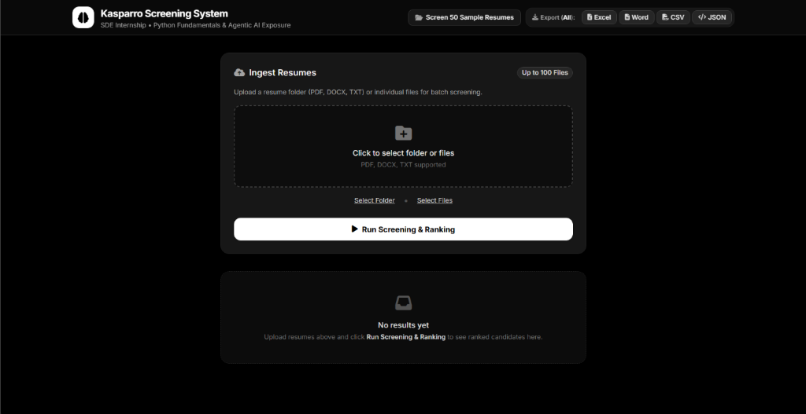
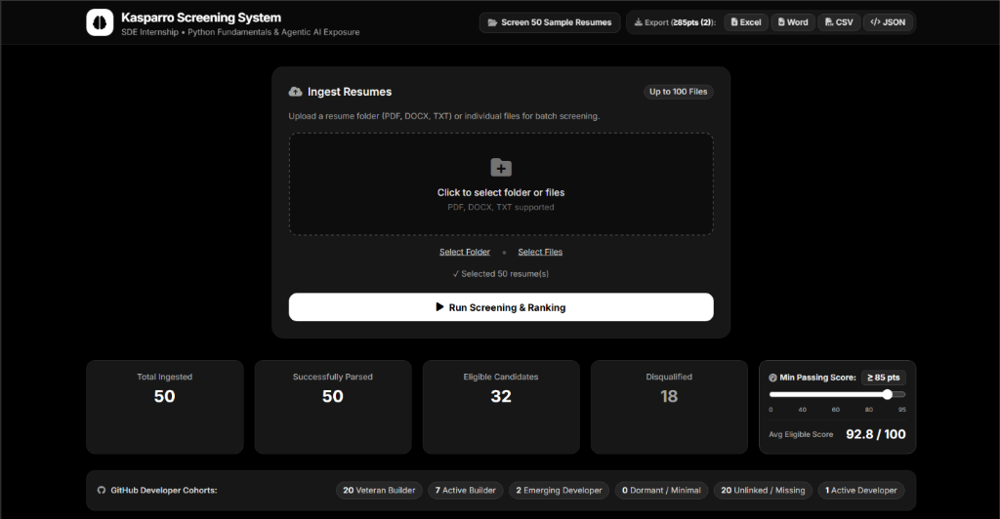
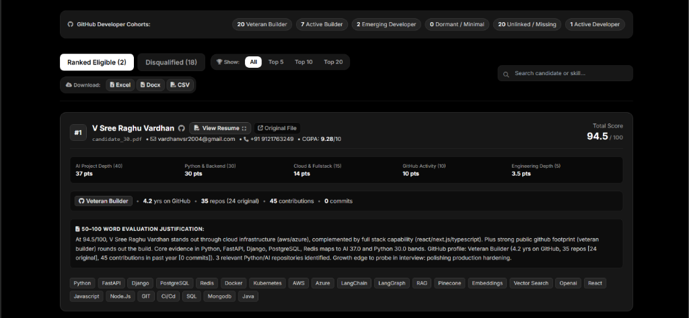
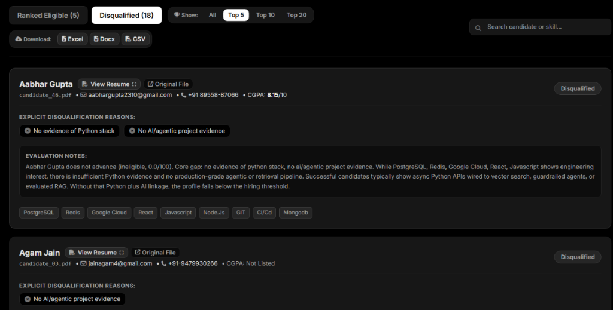
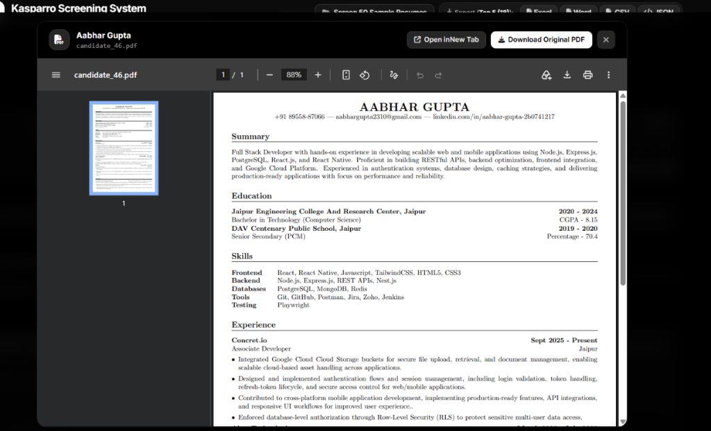
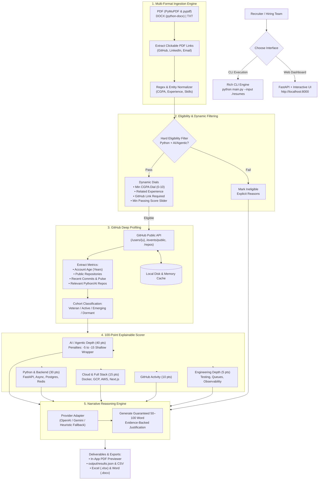

# Kasparro Candidate Screening & Ranking System

[](https://python.org)
[](https://fastapi.tiangolo.com)
[-brightgreen?logo=pytest)](https://pytest.org)
[](https://drive.google.com/file/d/1nqddYrIIKVO28ASI2HfX7R8T7xyGU0B7/view?usp=sharing)

An automated, explainable, production-minded candidate screening and ranking pipeline designed specifically for an **SDE Internship requiring strong Python fundamentals and practical exposure to AI/agentic systems**.

This system ingests candidate resumes (PDF, DOCX, TXT), extracts embedded clickable hyperlink annotations, enforces strict rule-based eligibility filters, enriches candidate profiles with public GitHub activity metrics and developer cohorts, evaluates candidates using a 100-point explainability rubric with penalties for shallow wrappers, generates 50–100 word narrative justifications, and surfaces results via both a Rich CLI and an interactive dark-mode web dashboard.

---

## 🎬 Video Walkthrough & Live Demo

> **Watch the full end-to-end system demo:**  
> 🔗 **[Click here to watch the Video Walkthrough on Google Drive](https://drive.google.com/file/d/1nqddYrIIKVO28ASI2HfX7R8T7xyGU0B7/view?usp=sharing)**

The video demonstration covers:
1. Batch resume ingestion and parsing across formats.
2. Real-time eligibility filtering and dynamic threshold dialing.
3. Live GitHub API enrichment and developer cohort segmentation.
4. Granular 100-point rubric evaluation with anti-wrapper penalty enforcement.
5. In-app side-by-side PDF previewing and multi-format reporting exports (Excel, Word, CSV, JSON).

---

## 🖥️ Interactive Web Dashboard Showcase

The web dashboard is a modern, responsive single-page application built on FastAPI that gives recruiters complete real-time visibility into the screening pipeline.

### 1. Batch Upload & Ingestion Hub
Upload up to 100 resumes at once via folder selection or drag-and-drop, or run instant screening on the pre-bundled 50 sample resumes with a single click.



---

### 2. Executive Analytics & Dynamic Passing Score Dial
Real-time batch summary showing total ingested, parsed, eligible, and disqualified counts, alongside interactive sliders for minimum passing score thresholding and GitHub developer cohort badges (*Veteran Builder*, *Active Builder*, *Emerging Developer*, *Dormant*, *Unlinked*).



---

### 3. Ranked Candidate Cards & 100-Point Rubric Breakdown
Inspect top-ranked candidates with itemized category score meters (AI Project Depth, Python Backend, Cloud/Fullstack, GitHub Activity, Engineering Depth), verified developer cohort tags, 50–100 word narrative justifications, and categorized technical skill chips.



---

### 4. Transparent Disqualification & Audit Trail
Every non-qualifying candidate is logged with clear, unambiguous disqualification tags (e.g., `No evidence of Python stack`, `No AI/agentic project evidence`) and full evaluation notes, eliminating black-box rejections.



---

### 5. In-App Embedded PDF Resume Viewer
Recruiters can inspect the original candidate PDF directly inside an embedded modal viewer complete with zoom, page navigation, search, and direct download links without ever leaving the application.



---

## 🏗️ Architecture Overview



---

## ⚡ Key Features

1. **Multi-Format Ingestion & Hyperlink Extraction**:
   - Parses `.pdf` (via `PyMuPDF` with `pypdf` fallback), `.docx`, and `.txt`.
   - **Clickable PDF URI Extraction**: Extracts embedded PDF hyperlink annotations (e.g., clickable GitHub or LinkedIn icons that do not expose raw text).
   - Fault-tolerant: Corrupted or unreadable files are recorded with descriptive errors without crashing the batch.

2. **Hard Rule-Based Eligibility Filter**:
   - **Python Stack Evidence**: Requires genuine Python development (FastAPI, Django, Flask, SQLAlchemy, etc.). Rejects pure JavaScript/Java/MERN candidates.
   - **AI / Agentic Exposure**: Requires demonstrable exposure to LangGraph, LangChain, ADK, LlamaIndex, RAG pipelines, embeddings, tool-calling agents, or vector databases.
   - Produces explicit rejection reasons for every disqualified candidate.

3. **Interactive Filter Dials & Live Thresholding**:
   - **CGPA Dial / Slider**: Normalizes 10-point scales, 4.0 GPA, and percentages to a standardized 10.0 scale.
   - **Passing Score Slider**: Dynamically filters top candidate bands (e.g. `>= 85 pts`).
   - **Related Experience & GitHub Link Toggles**: Configurable mandatory gates for recruiter workflows.

4. **GitHub Deep Profiling & Cohort Segmentation**:
   - **`account_age_years`**: Exact account age calculated from `created_at`.
   - **`public_repos`**: Total public repositories and count of relevant Python/AI repositories.
   - **`recent_commits`**: Commits extracted from public push events.
   - **Developer Cohorts**: Classifies candidates into *Veteran Builder* (3+ years, 10+ repos, active commits), *Active Builder*, *Emerging Developer*, *Dormant*, or *Unlinked*.
   - **Rate-Limit Resilience & Caching**: Supports optional `GITHUB_TOKEN`, handles HTTP 403 gracefully without failing the candidate, and caches profiles locally in `.github_cache.json`.

5. **100-Point Explainable Scoring Model**:
   - **AI / Agentic / RAG Project Depth (40 pts)**: Rewards multi-agent graphs, hybrid search RAG, tool calling, and evaluation pipelines.
     - **Penalties**: Deducts 5–15 points for shallow LLM API wrappers (e.g., single prompt-in/prompt-out with no retrieval, state, or tools) and tutorial-style projects without ownership.
   - **Python & Backend Engineering (30 pts)**: Rewards async FastAPI, PostgreSQL/SQLAlchemy, and Redis caching. Keyword-only mentions receive capped credit.
   - **Cloud / Deployment / Full Stack (15 pts)**: Docker, GCP/AWS, and supporting React/Next.js frontend.
   - **GitHub Activity (10 pts)**: 0–5 pts recent activity + 0–5 pts maintained/relevant repos.
   - **Engineering Depth Signals (5 pts)**: Unit testing (pytest), queues (Celery/Kafka), and observability.

6. **50–100 Word Narrative Justification Engine**:
   - Produces an explainable narrative between 50 and 100 words for every candidate (both ranked and disqualified) citing specific technical evidence.

7. **Multi-Format Export & In-App Viewer**:
   - In-app interactive PDF viewer with full toolbar controls.
   - One-click export to **Excel (.xlsx)**, **Word (.docx)**, **CSV**, and structured **JSON**.

---

## 🚀 Quick Start

### 1. Installation
Clone the repository and install dependencies:
```bash
git clone <repo-url>
cd Kasparro
pip install -r requirements.txt
```

### 2. Configuration (Optional)
Copy `.env.example` to `.env`:
```bash
cp .env.example .env
```
Key variables:
- `GITHUB_TOKEN`: (Optional) GitHub Personal Access Token to increase public API rate limits from 60 req/hr to 5,000 req/hr.
- `OPENAI_API_KEY` or `GEMINI_API_KEY`: (Optional) To use live LLM completions. If left unset, the system uses the built-in deterministic heuristic engine.

---

## 💻 Running the Application

### Option A: Interactive Web Dashboard (Recommended)
Launch the web server:
```bash
python main.py --serve
# Or specify a custom port:
# python main.py --serve --port 8000
```
Open **`http://localhost:8000`** in your browser. From the dashboard:
1. Click **"Screen 50 Sample Resumes"** to run batch screening with one click.
2. Upload a custom folder or files (up to 100 resumes).
3. Adjust the **Passing Score Slider** or **Minimum CGPA Dial**.
4. View candidate cards, inspect 50–100 word justifications, and click **"View Resume"** to preview PDFs inline.
5. Export results to **Excel**, **Word**, **CSV**, or **JSON**.

### Option B: Command Line Interface (CLI)
Screen resumes and export directly from the terminal:
```bash
python main.py --input ./resumes --output ./output/results.json
```

**Additional CLI Options**:
```bash
# Filter by minimum CGPA (e.g. 7.5/10)
python main.py --input ./resumes --min-cgpa 7.5

# Require related internship experience and a public GitHub link
python main.py --input ./resumes --require-experience --require-github

# Adjust concurrency (default: 5 worker threads)
python main.py --input ./resumes --concurrency 8
```

---

## 🔌 API Endpoints

- `GET /`: Interactive web dashboard.
- `GET /health`: Health status check.
- `POST /screen`: Screen a directory on the filesystem (`{"input_dir": "./resumes"}`).
- `POST /upload_and_screen`: Multipart file upload (up to 100 resumes) with filter form parameters.
- `GET /results`: Fetch the latest screening report JSON.
- `GET /download_csv`: Download results as a CSV spreadsheet.
- `GET /download_excel`: Download formatted Excel workbook.
- `GET /download_word`: Download structured Word executive summary document.
- `GET /resume_pdf/{filename}`: Stream resume PDF for embedded in-app modal preview.

---

## 📊 Output Schema (`output/results.json`)

The generated JSON matches the required schema with full evidence, score breakdown, and batch statistics:

```json
{
  "batch_summary": {
    "total_resumes": 50,
    "successfully_parsed": 50,
    "eligible": 32,
    "rejected": 18,
    "failed_unreadable": 0,
    "github_cohorts": {
      "Veteran Builder": 20,
      "Active Builder": 7,
      "Emerging Developer": 2,
      "Dormant / Minimal": 0,
      "Unlinked / Missing": 20,
      "Active Developer": 1
    },
    "average_score_eligible": 92.8
  },
  "ranked_candidates": [
    {
      "rank": 1,
      "candidate_name": "V Sree Raghu Vardhan",
      "file_name": "candidate_30.pdf",
      "eligible": true,
      "total_score": 94.5,
      "score_breakdown": {
        "ai_project_depth": 37.0,
        "python_backend": 30.0,
        "cloud_fullstack": 14.0,
        "github": 10.0,
        "engineering_depth": 3.5
      },
      "matched_skills": ["Python", "FastAPI", "Django", "PostgreSQL", "Redis", "Docker", "Kubernetes", "AWS", "LangGraph", "RAG"],
      "github_metrics": {
        "account_age_years": 4.2,
        "public_repos": 35,
        "recent_commits": 0,
        "cohort": "Veteran Builder"
      },
      "reason_50_to_100_words": "At 94.5/100, V Sree Raghu Vardhan stands out through cloud infrastructure (aws/azure), complemented by full stack capability (react/next.js/typescript). Plus strong public github footprint (veteran builder) rounds out the build. Core evidence in Python, FastAPI, Django, PostgreSQL, Redis maps to AI 37.0 and Python 30.0 bands. GitHub profile: Veteran Builder (4.2 yrs on GitHub, 35 repos [24 original], 45 contributions in past year [0 commits]). 3 relevant Python/AI repositories identified. Growth edge to probe in interview: polishing production hardening."
    }
  ],
  "rejected_candidates": [
    {
      "rank": null,
      "candidate_name": "Aabhar Gupta",
      "file_name": "candidate_46.pdf",
      "eligible": false,
      "total_score": 0.0,
      "rejection_reasons": [
        "No evidence of Python stack",
        "No AI/agentic project evidence"
      ],
      "matched_skills": ["PostgreSQL", "Redis", "Google Cloud", "React", "Javascript", "Node.js"],
      "reason_50_to_100_words": "Aabhar Gupta does not advance (Ineligible, 0.0/100). Core gap: no evidence of python stack, no ai/agentic project evidence. While PostgreSQL, Redis, Google Cloud, React, Javascript shows engineering interest, there is insufficient Python evidence and no production-grade agentic or retrieval pipeline. Successful candidates typically show async Python APIs wired to vector search, guardrailed agents, or evaluated RAG. Without that Python plus AI linkage, the profile falls below the hiring threshold."
    }
  ]
}
```

---

## 🏛️ Design Decisions

### 1. Ingestion & Embedded Link Extraction
Resumes submitted as PDFs often store GitHub and LinkedIn profiles as **clickable link annotations** attached to SVG icons rather than raw textual URLs. Relying solely on regular expressions on raw text would fail to extract GitHub profiles for over 30% of modern resumes. We implemented a hybrid strategy: `PyMuPDF` extracts all URI link annotations (`page.get_links()`), with regex fallback on text.

### 2. Hard Eligibility Filtering Strategy
Eligibility is kept intentionally rule-based and deterministic before any scoring occurs. We reject candidates who lack genuine Python evidence or meaningful AI/agentic project exposure. Candidates with complementary skills (e.g., React, TypeScript, Java) are **not** rejected as long as Python and AI exposure are present. This prevents well-formatted frontend resumes from scoring high.

### 3. Anti-Shallow Wrapper Scoring & Quality Penalties
To fulfill the requirement that candidates with superficial AI projects do not rank near the top, the scoring engine enforces quality penalties:
- **Shallow API Wrapper Penalty (-12 pts)**: If a resume lists OpenAI or Gemini completions without retrieval, state management, vector databases, or backend logic.
- **Tutorial Project Penalty (-8 pts)**: If projects follow common tutorial templates (e.g., basic To-Do apps, generic Titanic ML) without evidence of system ownership.
- **Skills-Only Cap**: Keyword mentions in the skills section receive minimal credit unless substantiated in project or experience sections.

### 4. LLM Usage & Fallback Design
The system uses an **Adapter Pattern** (`BaseLLMAdapter`). If an API key (`OPENAI_API_KEY` or `GEMINI_API_KEY`) is present, it uses structured LLM prompts to generate evaluations. If no API key is provided, or if the API times out/fails, it automatically falls back to our deterministic `HeuristicAdapter`. This ensures 100% offline testability, zero flaky test dependencies, and zero cost out of the box.

### 5. GitHub Deep Profiling & Resilience
GitHub contributes up to 10 points as an **enrichment booster**. A candidate with no GitHub or a private profile is never disqualified. Rate-limiting is handled by inspecting response status codes (HTTP 403/429) and continuing gracefully with 0 GitHub points while caching results in `.github_cache.json` to prevent redundant network requests.

---

## 🔮 If I Had More Time

If given additional time to extend the system, the next 4 improvements would be:

1. **Static AST Analysis of GitHub Repositories**:
   Instead of relying on GitHub API metadata alone, clone/inspect top public repositories to perform AST analysis on Python code (e.g., checking for type hints, pytest test coverage, async concurrency, and LangGraph state graph definitions).
2. **LangSmith / Ragas Evaluation Benchmark**:
   Implement an automated evaluation pipeline measuring the consistency and alignment of LLM resume rankings against human recruiter shortlists.
3. **Multi-Page OCR for Scanned Image Resumes**:
   Integrate Tesseract OCR or PaddleOCR for resumes submitted as non-searchable flattened images or scanned printouts.
4. **Interactive Weight Customizer in the Web Dashboard**:
   Allow hiring managers to adjust rubric category weights (e.g., increasing Cloud weight from 15% to 25% for infrastructure-heavy cohorts) directly from the UI dials with real-time re-ranking.

---

## 🧪 Test Suite

Run the comprehensive pytest suite:
```bash
python -m pytest -v
```

All **36 test cases** pass with 100% success across:
- `tests/test_api.py`: FastAPI endpoints, file uploads, PDF streaming, report downloads.
- `tests/test_filters.py`: Rule-based disqualification of non-Python/AI profiles, CGPA normalization.
- `tests/test_github.py`: API enrichment, rate-limit resilience, developer cohorting.
- `tests/test_narrative.py`: 50–100 word count validation and justification structure.
- `tests/test_parsers.py`: PDF link annotation extraction, text sanitization, corrupted file handling.
- `tests/test_scoring.py`: 100-point rubric breakdown and shallow wrapper penalty deductions.
